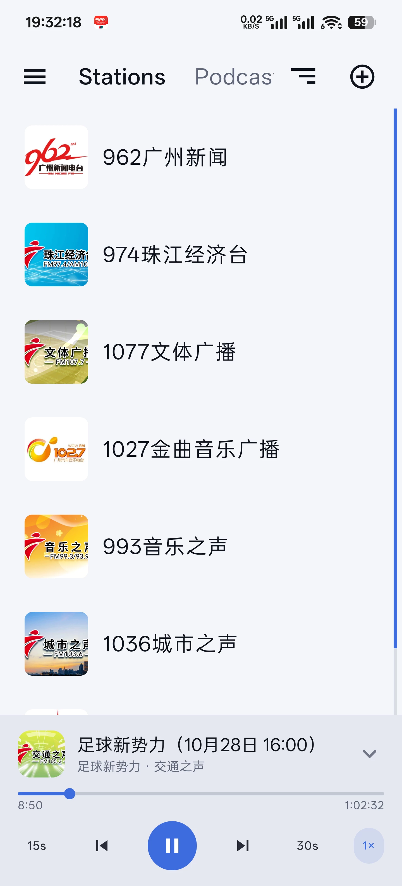
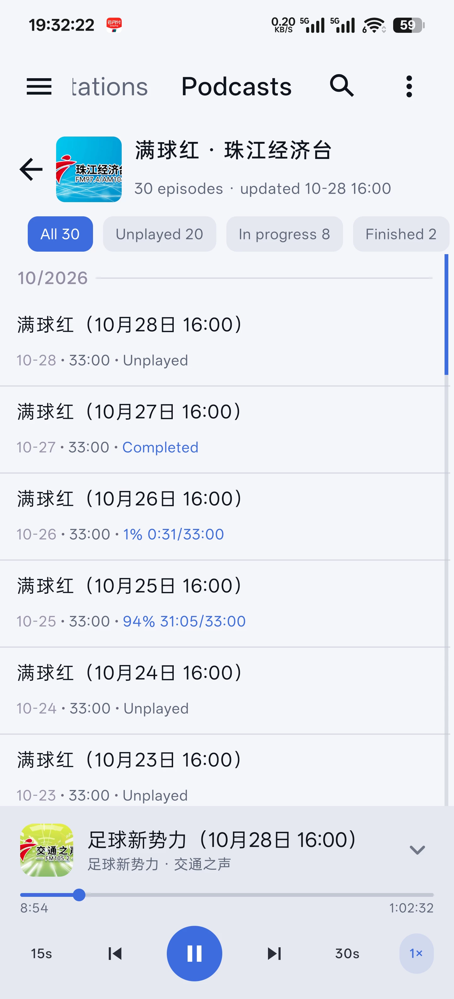
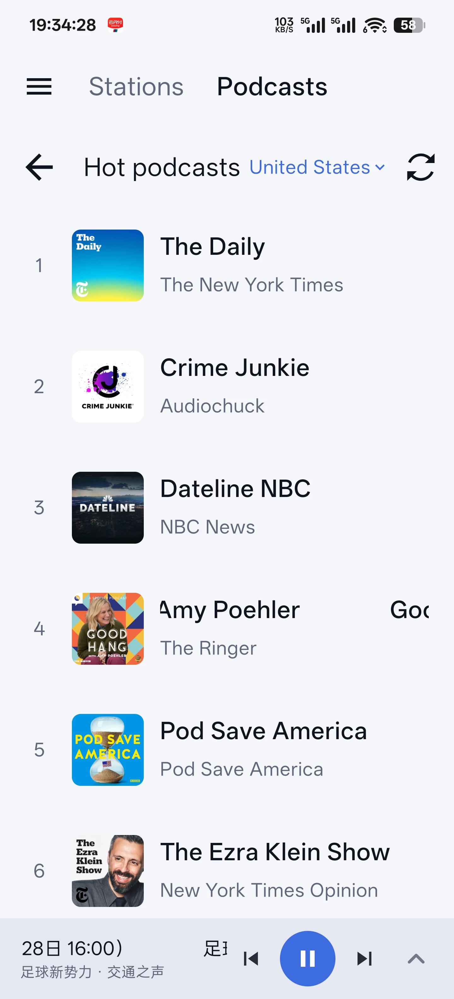
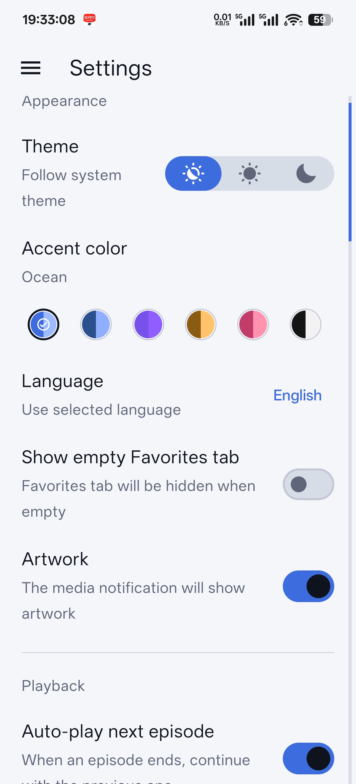

<h1 align="center">FanTing
</h1>

<p align="center">
  <a href="README_ZH.md">简体中文</a> · English
</p>

<p align="center">
  Open-source internet radio and podcast player for Android · Just open and listen
</p>

<p align="center">
  
  
  
</p>

<p align="center">
  
</p>

<p align="center">
  <b>~3.2 MB release APK</b> &nbsp;·&nbsp; <b>Runs on Android 8.0+</b> &nbsp;·&nbsp; <b>No ads / no sign-in</b>
</p>

FanTing is an open-source player that puts **internet radio** and **podcasts** in a single app. Build your own station library by hand, or search a huge public radio directory, preview stations and save the ones you like; subscribe to podcasts via RSS, search or charts, with resume, speed control and batch downloads.

The release APK is about **3.2 MB** and runs on Android 8.0 (API 26) and newer, so it fits older phones and devices short on storage. No ads, no trackers, no analytics, and no account. Your stations, subscriptions and playback progress stay on your own device.

## Features

### Radio

- **Two ways to add stations.** Enter the title, stream URL, artwork and tags by hand, or search online and add a station with one tap.
- **Online station search.** Powered by the public [Radio Browser](https://www.radio-browser.info) directory: search by title or tag, filter by country, language and bitrate range, and sort by clicks, votes, name, bitrate, country or random, in ascending or descending order. Preview a station before saving it.
- **Library management.** Favorites, tags, an artwork toggle, sorting by date added, name or favorites, and drag-and-drop for a fully custom order.
- **Player panel.** Shows artwork, live track metadata (ICY), bitrate, sample rate and audio format; tap the info area to copy the current track name, press and hold for full stream details. Shuffle, previous and next station.
- **Automatic artwork.** Settings can look up covers for all stations online and tells you when nothing is found.
- **Playback behaviour.** Choose how long the service keeps running after pause (or never stop it), whether playback resumes after another app takes audio focus, whether media controls stay in Quick Settings, whether the panel expands when playback starts, whether long titles scroll, and whether bitrate is shown.

### Podcasts

- **Every way to subscribe.** Paste an RSS URL, search the iTunes catalog by name or author, or browse popular charts; the search region can be the US, China, Taiwan, Hong Kong, Japan, South Korea, the UK or Germany.
- **Listening.** Episodes resume where you left off with progress saved automatically, 0.5× / 0.75× / 1× / 1.25× / 1.5× / 2× / 3× speed, skip back 15 s and forward 30 s, and auto-play of the next episode when one finishes.
- **Downloads.** Single and batch downloads, a mobile-data prompt (or Wi-Fi only), download progress and storage usage, export audio files, and clear all downloads at once.
- **Episode management.** Favorite episodes, mark played or unplayed, filter by all / unplayed / in progress / finished, search episodes, press and hold to slide-select for batch actions, sort by newest / oldest / last updated / title, and choose standard, compact or cover-only layouts.
- **Auto refresh.** Refresh on app start, when opening the Podcasts tab, with a minimum interval of 10 minutes / 1 hour / 6 hours / 24 hours; manual refresh is never limited.

### General

- **Ultra light.** The release APK is about 3.2 MB, with no embedded browser engine and no ad or analytics SDKs; permissions are limited to what playback and networking require.
- **System playback controls.** Control playback from the notification, lock screen, Quick Settings and the system media panel — even resume the last station from Quick Settings while the app isn't running.
- **Android Auto.** The car interface offers all stations, favorites, tags and recently played, and follows the list order saved in the app.
- **Portable data.** A full JSON backup (stations, sorting, podcast subscriptions, episode progress, playback history) and a plain TXT format (stations only, editable by hand), with **replace** or **merge** on import.
- **Appearance.** Light, dark and system themes, plus six accent colors (violet, ocean, navy, amber, rose, taiji).
- **Languages.** Simplified Chinese, Traditional Chinese, English and Russian, switchable in the app; the system language is used by default.
- **Tablet layouts.** Dedicated layouts for phones, 7-inch and 10-inch tablets.
- **In-app updates.** GitHub builds can check for and download new APKs from the About page.

## Supported formats

- Direct stream URLs (HTTP / HTTPS)
- PLS
- M3U
- HLS / M3U8
- XSPF
- ASX / WAX / WMX
- DASH / MPD

## Screenshots

| Stations | Podcasts |
| :---: | :---: |
|  |  |
| **Discover podcasts** | **Settings** |
|  |  |

## Installation

Download the latest APK from [Releases](https://github.com/ruzhe85/FanTing/releases), around 3.2 MB, and install it directly.

- Requires Android 8.0 (API 26) or newer
- Application ID: `app.ruzhe.fanting`, so it can be installed alongside the upstream OmniBeatP
- Updating in place requires the same signing key as the installed build

## Backup format

**JSON** is the native backup format. It stores stations, sorting, podcast subscriptions and episode progress, and playback history, which makes it suitable for moving to a new device or long-term archiving.

**TXT** stores stations only, three lines per station: title, stream URL, and optional comma-separated tags. You can maintain it in any text editor.

```txt
Nightride FM
https://stream.nightride.fm/nightride.mp3
synthwave, electronic

Classic Vinyl HD
https://icecast.walmradio.com:8443/classic
mp3, 320 kbps
```

On import you can **replace** your data, or **merge** it and update duplicate stations by stream URL.

## Privacy

- No analytics, tracking or crash reporting
- No account, and your station library and podcast subscriptions are never uploaded
- Network access is only used for: online station search (Radio Browser), podcast search and charts (iTunes), artwork and RSS fetching, and update checks for GitHub builds

## Acknowledgements

FanTing is a continuation of [OmniBeatP](https://github.com/Vikindor/omnibeat) by Vikindor. Thanks to the original author and to these open-source projects:

- [AndroidX Media3 / ExoPlayer](https://github.com/androidx/media): audio playback, media sessions and system playback controls
- [Reorderable](https://github.com/Calvin-LL/Reorderable): drag-and-drop sorting in Compose
- [Radio Browser](https://www.radio-browser.info): online station directory and station metadata
- [iTunes Search API](https://performance-partners.apple.com/search-api): podcast search and chart data

## License

[GNU Affero General Public License v3.0](LICENSE)
